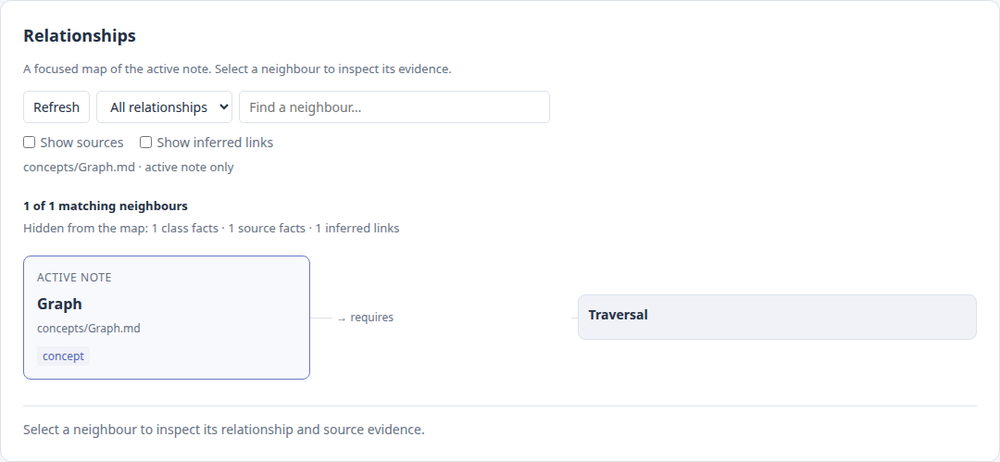

# Knowledge Forge

Knowledge Forge is an offline Obsidian plugin for turning note relationships into typed triples, reviewing their sources, and preparing GraphRAG context. It works with ordinary Markdown, YAML frontmatter, and wikilinks. Breadcrumbs and Dataview are optional; no external service or model is called.

**Plugin ID:** `kg-forge` · **Minimum Obsidian:** 1.13.0 · **License:** MIT

## What works

- Extract subject–predicate–object relationships from `fileClass`, `source_ids`, a `## Connections` section, and body wikilinks.
- Keep full vault paths as note identities, including notes with the same filename in different folders. Obsidian resolves aliases, headings, and relative links.
- Inspect a focused relationship map around the active note, refreshed when the note or its metadata changes. Neighbours have compact names, directional relationship labels, and folder context when names collide. Select a neighbour for evidence and an explicit Open note action.
- Build a GraphRAG prompt: choose an anchor, enter a question, set a radius of 0–5 relationship hops, generate a preview, inspect the evidence, and copy the displayed text. Shared class labels and unresolved targets cannot join unrelated notes. Prompts include at most 500 facts.
- Validate folder/fileClass contracts and source IDs, including broken mapped targets. Nested folder mappings use the most specific match.
- Export Cypher statements and Dataview query templates. Generated output folders are created automatically and excluded from plugin scans.
- Save competency questions in plugin data. **Check coverage** reports lexical overlap with graph terms; it is a hint, not proof that a question is answerable. Editing a question clears its previous hint.

Provenance identifies the originating note, capture time, extraction confidence, and lineage. Confidence values are extraction heuristics, not calibrated probabilities or independent verification of a claim. The plugin prepares context and renders a deterministic active-note map. Model answers require a separate tool or service.

## Install from source

Build outside your personal vault, then copy the three runtime files into a test vault first:

```bash
git clone https://github.com/Jimmycarroll2021/obsidian-kg-forge.git
cd obsidian-kg-forge
npm ci
npm run check
```

Use Node.js 22 for development. Copy `main.js`, `manifest.json`, and `styles.css` to `<vault>/.obsidian/plugins/kg-forge/`. In Obsidian, enable **Knowledge Forge** under **Settings → Community plugins**. The development workflow is documented in [DEVELOPMENT.md](DEVELOPMENT.md).

Alternatively, a repository release supplies those same runtime files. This repository does not imply that the plugin is listed in Obsidian's community directory.

## First usable workflow

Open a Markdown note and run **Knowledge Forge: Extract triples from current note**. A source index is optional: missing indexes do not stop extraction or prompt generation. Unresolved source IDs remain visible as IDs and produce validation warnings.

This note shows the supported conventions:

```markdown
---
fileClass: concept
source_ids:
  - SRC-DEMO
---
# Graph

## Connections
requires:: [[Traversal]]
source:: SRC-DEMO

## Notes
See [[algorithms/Shortest path#Method|shortest paths]].
```

Relationship fields supported inside `## Connections`: `up`, `down`, `same`, `next`, `prev`, `source`, `requires`, `enables`, and `related_to`. Body wikilinks become inferred `links_to` relationships. Code examples are excluded. An explicit `fileClass` takes precedence over folder inference; validation still reports a disagreement with the folder contract.

If you use source IDs, create an index at the configured **Source map path** (default `papers/index.md`):

```markdown
| Source ID | Title | Target File | Wikilink |
| --- | --- | --- | --- |
| SRC-DEMO | Demo reference | papers/Graph.md | [[Graph|reference]] |
```

Links in the index resolve relative to the index note. A three-column table without a title also works when its headers identify Source ID, Target File, and Wikilink. IDs use `SRC-` followed by letters, digits, underscores, or hyphens. Empty target cells and aliases are preserved during parsing.

Try [the sample vault](examples/README.md) for duplicate names, a linked neighbourhood, an isolated concept, and a deliberately unmapped source.

## Commands

Obsidian prefixes these commands with **Knowledge Forge**.

| Command | Result |
| --- | --- |
| Extract triples from current note | JSON cache for the active source note |
| Open knowledge graph | Focused active-note map with selected provenance |
| Build graphrag prompt | Question, anchor, preview, evidence, and copy modal |
| Validate vault schema | Markdown report opened in a new leaf |
| Export triples as Cypher | Local `.cypher` export |
| Generate Dataview query templates | Markdown query examples; running them requires Dataview |
| Open competency questions | Persistent question collection and coverage hints |

## Read a focused map

Run **Open knowledge graph** with a source note active. The map starts with explicit relationships and shows at most **12 neighbours per page**. It groups multiple relationships to the same note into one card. Classes appear as badges on the active note; source facts and inferred body links are hidden initially. Use **Show sources** and **Show inferred links** to reveal them. Counts distinguish hidden facts, filtered neighbours, and neighbours on other pages.

Search for a neighbour or choose a predicate to narrow the map. Select a card with the mouse or keyboard to inspect its provenance; evidence is paged separately at eight facts per page. **Open note** opens that exact target. Unresolved targets are marked and keep that button disabled. Duplicate note names retain their folder context. The layout stacks in narrow panes and follows the Obsidian theme.



*Actual plugin rendering in a browser fixture with synthetic notes and a mocked Obsidian host.*

The map reads the active note and the configured source index. It does not scan all vault contents to draw the view. For a broader multi-hop neighbourhood, use the GraphRAG command.

## Settings and generated files

Default folder mappings are `algorithms=algorithm`, `books=book`, `concepts=concept`, and `papers=paper`. Change them for your vault's exact paths; nested mappings such as `research/papers=paper` are supported. A missing `fileClass` can be inferred for extraction and still appears as a schema error.

The output folder defaults to `Knowledge Forge`, visible in Obsidian's file explorer. Hidden output paths are rejected because this workflow uses Obsidian's visible-file Vault API. The legacy default `.kg-forge` setting migrates to `Knowledge Forge`; old caches remain untouched. The plugin creates nested directories, rejects absolute paths and parent traversal, protects the Obsidian configuration directory, and refuses to replace an ordinary note at an output target. Use a dedicated output folder. Regenerating an artifact replaces edits made inside that generated artifact.

| Artifact | Default path |
| --- | --- |
| Note cache | `Knowledge Forge/<full-note-path>.triples.json` |
| Schema report | `Knowledge Forge/schema-validation-report.md` |
| Cypher export | `Knowledge Forge/kg-forge-export.cypher` |
| Dataview templates | `Knowledge Forge/dataview-queries.md` |

Previously generated reports and exports can be updated. Existing basename-only caches remain on disk; new caches include the full source path so duplicate names stay separate. Cypher exports use canonical path IDs too: importing into an existing store that used basename IDs requires an explicit migration or a separate database to avoid retaining both identities.

Questions and settings live in Obsidian's plugin `data.json`. A save failure is displayed and questions offer **Retry save**. Copying a GraphRAG prompt places selected vault content on your clipboard; you choose where to use it.

## Verification and contributions

`npm run check` runs lint, TypeScript, regression tests, and the production bundle. Tests cover engine behaviour, safe outputs, persistence, UI lifecycles, and the sample-vault command journey. Obsidian APIs are mocked in automated tests; native host validation and executing an export in Neo4j are separate checks. See [the delivery record](docs/DELIVERY.md) for the repair scope and evidence.

Report bugs with the Obsidian/plugin version, steps to reproduce, and a small sample note without private content. Future work can build on this foundation: whole-vault graph exploration, semantic question evaluation, and opt-in model integration need their own acceptance criteria.
